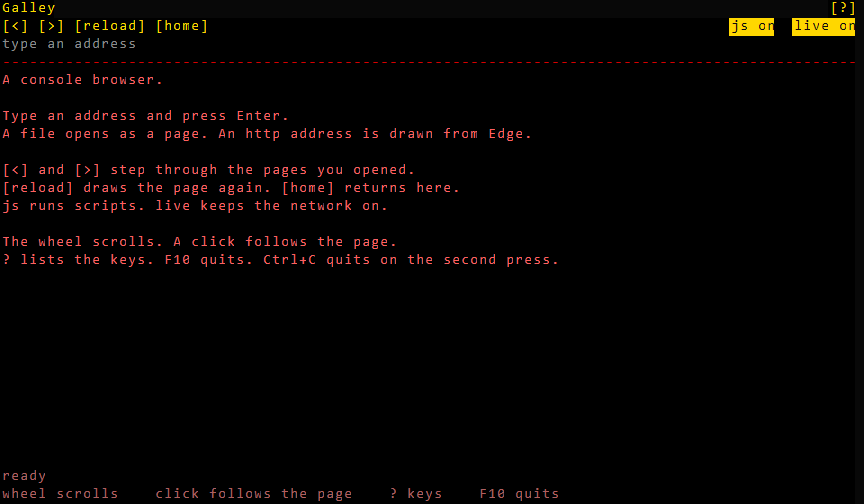
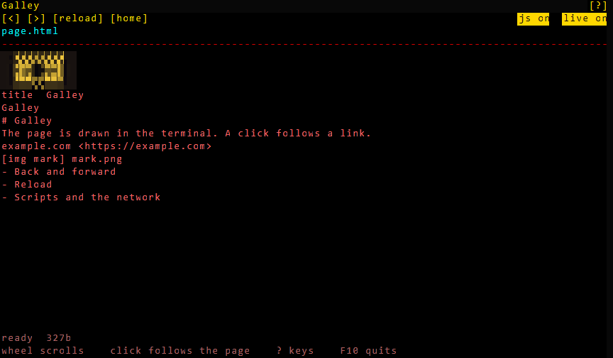
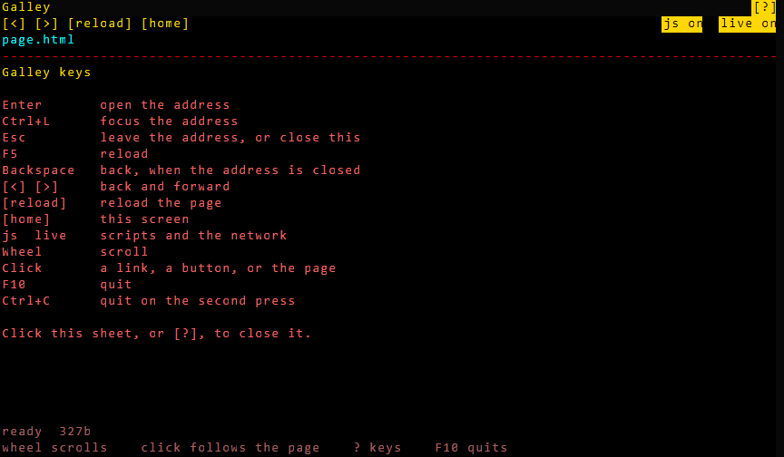

# Galley

Galley is a console browser. It draws the page in the terminal.

It runs inside a terminal that is already open. It has no window of its own. Type an address and press Enter. A local file is drawn as text and pictures. An `http` or `https` address is laid out by headless Edge or Chrome, then drawn in the same cells. Scripts and the network start on. The `js` and `live` chips turn them off.

The wheel scrolls. A click follows a link, a button, or the page. `[<]` and `[>]` step through the pages you opened. `[reload]` draws the page again. `[home]` returns to the start. `?` lists the keys. F10 quits. Ctrl+C quits on the second press.

```
galley
galley https://example.com
galley page.html
galley frame screen
```

`galley frame <dir>` writes the pictures below. The frames are 96×28.

## Screens

Home. The address is empty until you type one.



A local page. The picture is drawn in the cells. A link shows its address.



Keys. `[?]` opens this sheet over the page.



## Keys

| Key | What it does |
| --- | --- |
| Enter | Open the address |
| Ctrl+L | Focus the address |
| Esc | Leave the address, or close this sheet |
| F5 | Reload |
| Backspace | Back, when the address is closed |
| `[<]` `[>]` | Back and forward |
| `[reload]` | Reload the page |
| `[home]` | The start screen |
| `js` `live` | Scripts and the network |
| Wheel | Scroll |
| Click | A link, a button, or the page |
| F10 | Quit |
| Ctrl+C | Quit on the second press |

## Build

From this directory:

```
cargo run
```

Without a terminal the program prints `galley: run this inside a terminal` and exits.

## License

MIT. Copyright 2026 Sergii Ziborov.
